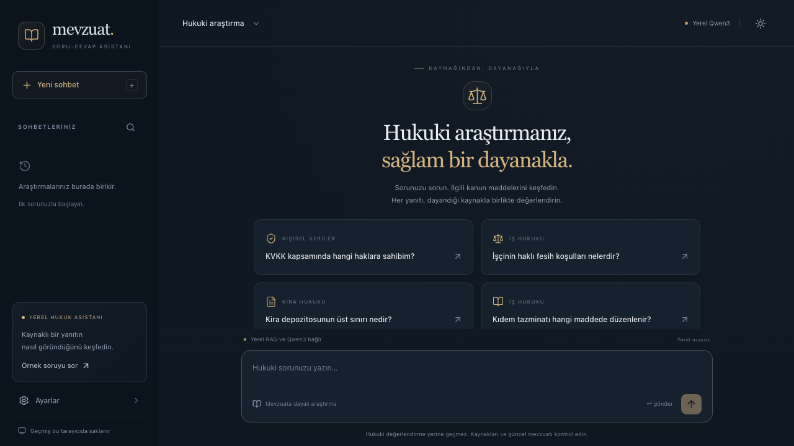
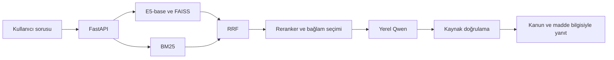

# Mevzuat Soru-Cevap Asistanı

Resmî kanun metinleri üzerinde ilgili kaynakları bulup **kanun ve madde bilgisiyle yanıt sunan yerel bir RAG uygulaması**.

React arayüzü, FastAPI, E5-base embedding, FAISS, BM25, RRF ve cross-encoder yeniden sıralama birlikte çalışır. Yerel Qwen modeli bulunan kaynaklardan kanıt seçer. Kullanıcıya sunulan metin, kaynak kontrollerinden geçen mevzuat alıntılarından oluşturulur.



## Özellikler

- Türkçe soru ve kanun/madde bilgisiyle kaynak gösterimi.
- Anlam tabanlı dense arama ve BM25 sözcük aramasını birleştiren hibrit erişim.
- Açık kanun/madde atıflarını koruma ve farklı maddelerden bağlam seçimi.
- Kaynak kimliği, kaynak metni ve model seçimi kontrolleri.
- Kaynak yetersizliğinde veya kontrol başarısızlığında taslağı yayımlamama.
- Apple Silicon üzerinde MLX, alternatif olarak Ollama üzerinden yerel model çalıştırma.
- Koyu/açık tema, kaynak paneli ve tarayıcıda saklanan sohbet geçmişi.

## Sistem akışı



| Bileşen | Kullanılan teknoloji |
|---|---|
| Arayüz | React, TypeScript, Tailwind CSS, Radix UI, Lucide |
| API | FastAPI |
| Embedding | `intfloat/multilingual-e5-base`, 768 boyut |
| Vektör araması | FAISS `IndexFlatIP` |
| Sözcük araması | BM25Okapi |
| Birleştirme | RRF, sıra sabiti 60 |
| Reranker | `cross-encoder/mmarco-mMiniLMv2-L12-H384-v1` |
| Mac üzerindeki LLM | `mlx-community/Qwen3-4B-Instruct-2507-4bit` |
| Alternatif model servisi | Ollama `qwen3:4b-instruct-2507-q4_K_M` |

Arama kanalları en fazla 50'şer chunk getirir. En fazla 80 aday yeniden sıralanır; bağlam en fazla dört farklı madde ailesinden hazırlanır. Aynı maddeye ait kardeş parçalar da eklenebilir. Bu sayılar cevap doğruluğu garantisi değildir.

## Gereksinimler

- Docker Desktop ve Docker Compose v2.
- Apple Silicon/MLX yolu için Python 3.12.
- Alternatif Ollama yolu için kurulu ve çalışan Ollama.
- İlk kurulumda bağımlılıkları ve model dosyalarını indirmek için internet erişimi.

Model ağırlıkları bu depoya dahil değildir. Mevzuat verisi ve onunla eşleşen başlangıç FAISS indeksi depoda bulunur. API anahtarı veya ücretli servis gerekmez.

## Kurulum

```sh
git clone https://github.com/mertcandemirr/mevzuat-rag-release.git
cd mevzuat-rag-release
cp .env.example .env
```

Depo özel tutuluyorsa klonlama sırasında GitHub hesabınızın depoya erişimi olmalıdır.

Windows PowerShell karşılığı: `Copy-Item .env.example .env`.

### Apple Silicon üzerinde MLX

Mac terminalinde model işçisini başlatın:

```sh
python3.12 -m venv .venv-mlx
.venv-mlx/bin/pip install mlx-lm==0.32.2
.venv-mlx/bin/python -m backend.llm_server
```

İlk çalıştırmada sabit revizyondaki model ağırlıkları Hugging Face önbelleğine indirilir. Bu terminali açık bırakın. Model hazır olduğunda:

```sh
curl http://127.0.0.1:8012/health
```

Varsayılan `.env.example`, Docker içindeki API'yi `http://host.docker.internal:8012` üzerinden Mac üzerindeki modele bağlar. Docker'ın açılması, Mac üzerindeki MLX işçisini otomatik başlatmaz.

İkinci terminalde arayüz ve backend'i başlatın:

```sh
docker compose up --build -d
docker compose ps
curl http://127.0.0.1:8021/api/health
```

**Arayüz:** [http://localhost:8080](http://localhost:8080)
**API belgeleri:** [http://localhost:8021/docs](http://localhost:8021/docs)

Portları `.env` içindeki `WEB_PORT` ve `API_PORT` değerleriyle değiştirebilirsiniz. Örneğin 18080 ve 18021 seçerseniz adresler de buna göre değişir.

### Alternatif olarak Ollama

Ollama kurulu ve açıkken modeli hazırlayın:

```sh
ollama pull qwen3:4b-instruct-2507-q4_K_M
```

`.env` dosyasına aşağıdaki ayarları ekleyin. Bu yol MLX işçisi yerine Ollama adaptörünü kullanır:

```dotenv
COMPOSE_PROFILES=ollama
MEVZUAT_LLM_URL=http://worker:8012
OLLAMA_URL=http://host.docker.internal:11434
```

Ardından `docker compose up --build -d` çalıştırın. Adaptör model etiketini ve beklenen digest önekini kontrol eder; farklı model çıktısını sessizce kabul etmez.

Linux'ta modeli de container içinde çalıştırmak için `COMPOSE_PROFILES=ollama,linux-model` ve `OLLAMA_URL=http://ollama:11434` kullanın:

```sh
docker compose up -d ollama
docker compose exec ollama ollama pull qwen3:4b-instruct-2507-q4_K_M
docker compose up --build -d
```

## Proje yapısı

```text
backend/
  api.py             İstek yönetimi ve model servisi bağlantısı
  rag.py             Dense/BM25, RRF, reranking ve bağlam seçimi
  resources.py       Model, korpus ve indeks bütünlük kontrolü
  query.py           Arama terimlerinin genişletilmesi
  scope.py           Açık kanun/madde atıflarının kapsam kontrolü
  terms.py           Sözcük tokenizasyonu ve atıf çıkarımı
  grounding.py       Kaynak seçimi ve uygunluk istemleri
  validation.py      Kaynak kimliği/metni ve sonuç kontrolü
  llm_server.py      Yerel MLX model servisi
  ollama_worker.py   Alternatif Ollama adaptörü
frontend/            React uygulaması ve Nginx yapılandırması
data/kanunlar/       Kaynak metinler, chunk'lar ve kaynak envanteri
data/index/          FAISS başlangıç indeksi ve manifest
scripts/             İndeks oluşturma ve kaynak smoke kontrolü
licenses/            Veri kaynaklarına ilişkin lisans ve bildirimler
```

## Veri kapsamı ve indeks

Bu sürüm 10 kanun, 1.326 madde kimliği ve 4.288 chunk içerir. Kapsam: **1475, 2709, 3071, 4749, 4857, 4982, 5018, 6098, 6698, 7201**. 1475 sayılı Kanun için yalnız m.14 bulunur. 657, ayrıştırma uyuşmazlıkları nedeniyle kapsam dışıdır.

Chunk kayıtları kanun/madde, fıkra/bent, üst madde kimliği, kaynak URL'si ve kaynak görüntüsü bilgilerini taşır. FAISS indeksi modele, revizyona ve korpus özetine bağlıdır. Başlangıçta SHA-256 ve boyut kontrolleri yapılır; eşleşmeyen indeks yüklenmez.

Başlangıç indeksi üzerine yazmadan yeni bir indeks oluşturmak için:

```sh
docker compose run --rm --no-deps backend python -m scripts.build_index /indexes/v2
```

Sonra `.env` içinde `INDEX_DIR=/indexes/v2` ayarlayıp `docker compose up -d` çalıştırın. Başlangıç indeksine dönmek için `INDEX_DIR=/app/data/index` kullanın. Veri dosyaları Docker'a salt okunur bağlanır.

## Kontrol ve sorun giderme

```sh
# Arayüz üzerinden API/model sağlık kontrolü
curl http://127.0.0.1:8080/api/health

# Son backend kayıtları
docker compose logs --tail=40 backend

# Model ve API açıkken beş soruluk kaynak kontrolü
python3 scripts/smoke.py --url http://127.0.0.1:8080
```

Smoke kontrolü doğru kaynağın seçilmesini ve metin eşleşmesini denetler; bağımsız hukuki cevap doğruluğu ölçümü değildir. Bu komutun geçmesi garanti edilmez, her soru için gerçek sonucu raporlar.

- **Backend `unhealthy` / HTTP 503:** Önce MLX veya Ollama servisinin hazır olduğunu kontrol edin.
- **Port görünmüyor:** Compose grup başlığı yerine `frontend` ve `backend` container satırlarına bakın. `docker compose ps` ile durumlarını kontrol edin.
- **Port kullanımda:** `.env` içinden farklı `WEB_PORT` veya `API_PORT` seçin.
- **macOS dosya erişimi:** Docker'ın proje klasörüne okuma erişimi olduğundan emin olun.

```sh
docker compose stop       # Durdur
docker compose start      # Mevcut container'ları başlat
docker compose down       # Container'ları kaldır; verileri silmek için -v eklemeyin
```

`down` sonrasında yeniden başlatmak için `docker compose up -d` gerekir. MLX işçisi bu komutlardan bağımsızdır.

## Sınırlar ve güvenlik

Kaynak metnin gerçek olması, cevabın soruya uygun veya eksiksiz olduğu anlamına gelmez. Tam yürürlük ve tarihsel sürüm çözümü tamamlanmamıştır. Yargı kararları ve kişisel dosyalar bu sürümün kapsamında değildir. Mevzuat metinlerini ilgili resmî kaynak ve görüntü tarihiyle karşılaştırın.

Servis portları varsayılan olarak yalnız `127.0.0.1` üzerinde açılır. Kimlik doğrulaması içermeyen bu geliştirme yapılandırmasını doğrudan internete açmayın. `.env`, erişim anahtarları, kullanıcı kayıtları, model ağırlıkları ve yerel çalışma dosyaları Git'e dahil edilmez. `.env.example` yalnız örnek yerel adresler ve portlar içerir.

## Veri kaynakları ve geliştirme notu

Kaynak adresleri ve dosya özetleri `data/kanunlar/kaynaklar.json` dosyasındadır. Veri kaynağı lisans/bildirim belgeleri `licenses/` altında korunur; bu belgeler tüm proje kodu için otomatik lisans beyanı olarak yorumlanmamalıdır.

Geliştirme ve dokümantasyon sürecinde yapay zekâ desteği kullanılmıştır.
